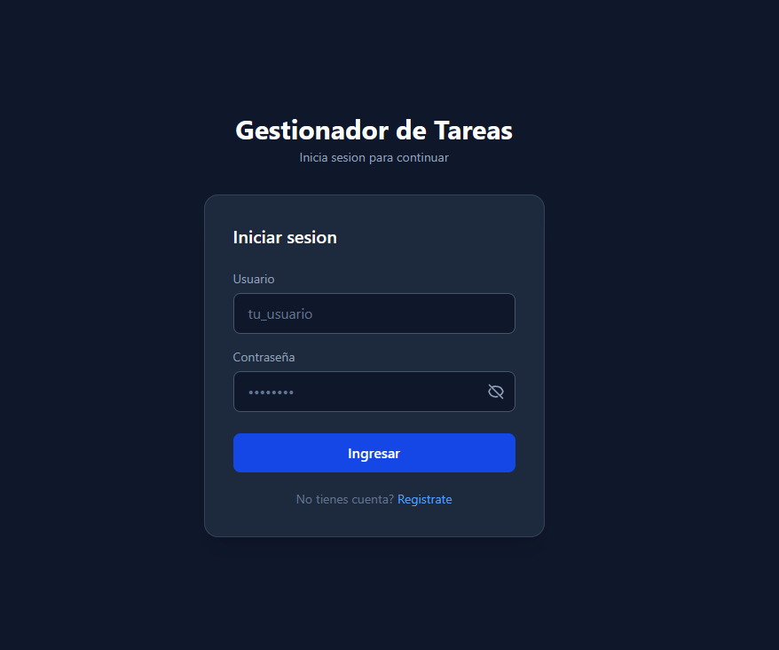
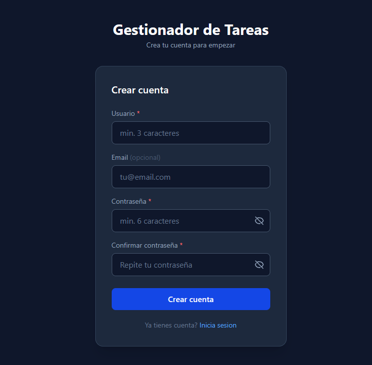
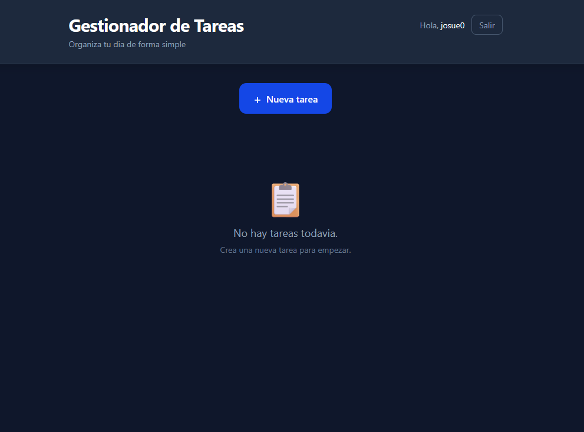
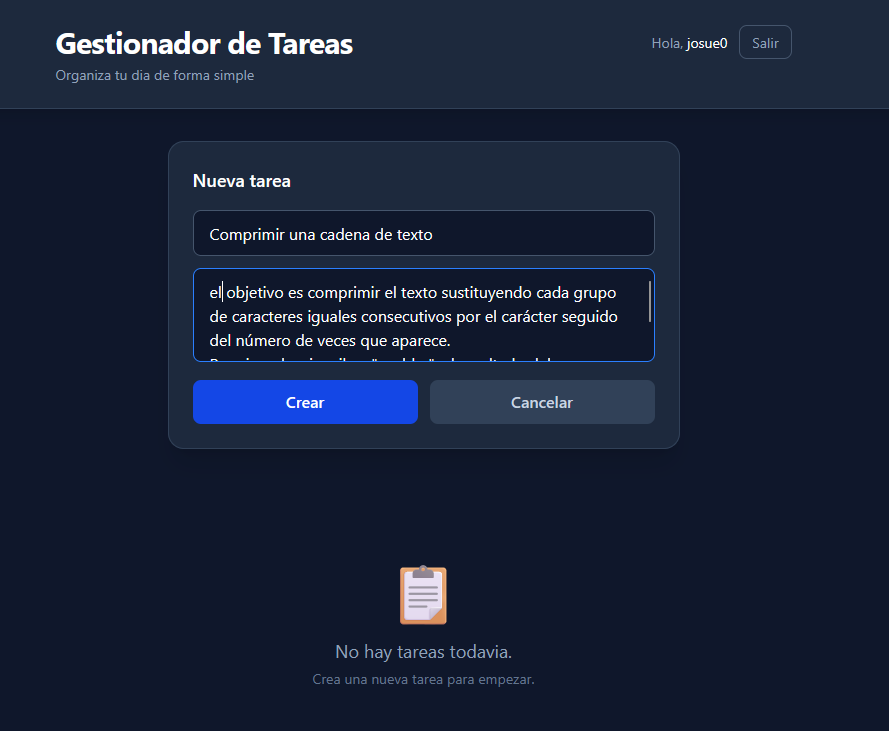
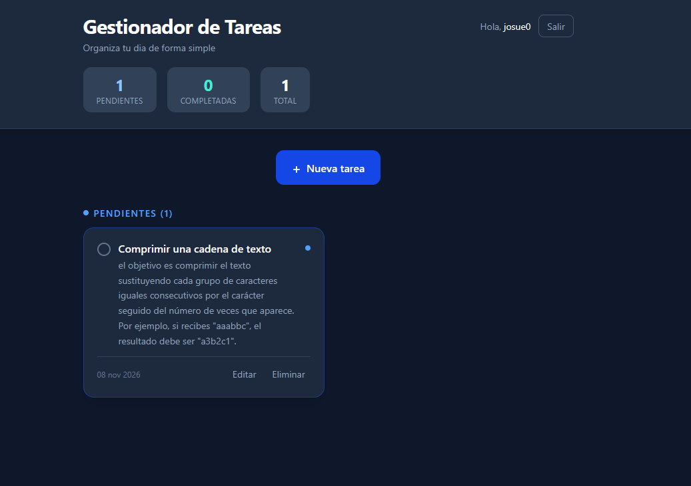
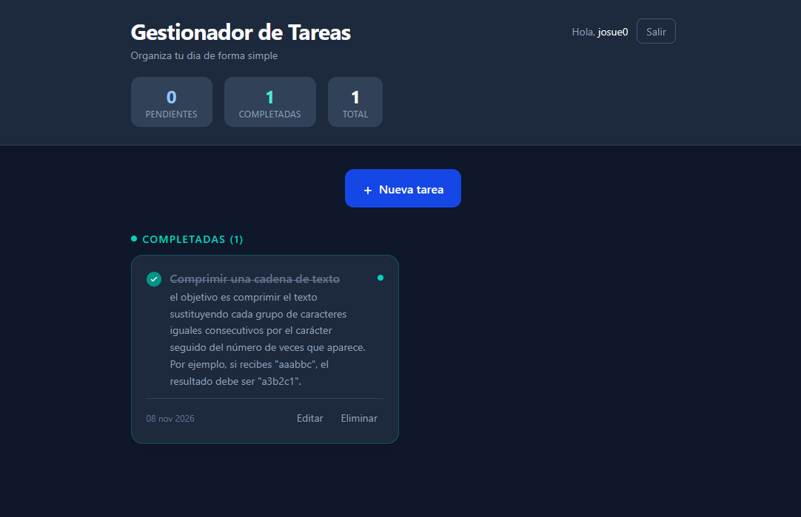

# Gestionador de Tareas

### Organiza tus pendientes en un espacio personal, sencillo y seguro

Aplicación web full-stack para gestionar tareas personales mediante una interfaz moderna y una API REST protegida con JSON Web Tokens.

---

## Descripción

**Gestionador de Tareas** es una aplicación web full-stack diseñada para centralizar la organización diaria de cada usuario en un espacio privado. Permite crear una cuenta, iniciar sesión y administrar tareas mediante un ciclo CRUD completo: crear, consultar, editar, marcar como completadas o pendientes y eliminar. La interfaz separa visualmente ambos estados y actualiza los contadores de pendientes, completadas y total después de cada acción.

Más allá de la funcionalidad visible, el proyecto demuestra la integración de una **Single Page Application construida con React** y una **API REST desarrollada con Django REST Framework**. El frontend consume la API con `fetch`, protege la navegación según el estado de la sesión y envía un token JWT en las operaciones privadas. En el servidor, cada consulta se filtra por el usuario autenticado; por tanto, una cuenta no puede consultar ni modificar las tareas de otra.

La solución utiliza SQLite durante el desarrollo y puede cambiar a PostgreSQL mediante una variable de entorno, sin alterar el código de negocio. El frontend y el backend también están preparados para desplegarse como proyectos independientes en Vercel. Esta separación mantiene claras las responsabilidades de presentación, comunicación HTTP, autenticación y persistencia, y convierte el repositorio en una muestra compacta de desarrollo web de extremo a extremo.

> **Demo:** [gestionador-de-tareas.vercel.app](https://gestionador-de-tareas.vercel.app)

## Contenido

- [Capturas de la aplicación](#capturas-de-la-aplicación)
- [Funcionalidades](#funcionalidades)
- [Arquitectura](#arquitectura)
- [Flujo de autenticación](#flujo-de-autenticación)
- [Tecnologías](#tecnologías)
- [Modelo de datos](#modelo-de-datos)
- [API REST](#api-rest)
- [Estructura del proyecto](#estructura-del-proyecto)
- [Instalación local](#instalación-local)
- [Variables de entorno](#variables-de-entorno)
- [Scripts disponibles](#scripts-disponibles)
- [Despliegue](#despliegue)
- [Decisiones técnicas](#decisiones-técnicas)
- [Mejoras futuras](#mejoras-futuras)
- [Autor](#autor)

## Capturas de la aplicación

### Autenticación

<table>
  <tr>
    <td align="center"><strong>Inicio de sesión</strong></td>
    <td align="center"><strong>Creación de una cuenta</strong></td>
  </tr>
  <tr>
    <td></td>
    <td></td>
  </tr>
</table>

### Flujo principal

<table>
  <tr>
    <td align="center"><strong>Estado inicial</strong></td>
    <td align="center"><strong>Creación de una tarea</strong></td>
  </tr>
  <tr>
    <td></td>
    <td></td>
  </tr>
  <tr>
    <td align="center"><strong>Tarea pendiente</strong></td>
    <td align="center"><strong>Tarea completada</strong></td>
  </tr>
  <tr>
    <td></td>
    <td></td>
  </tr>
</table>

## Funcionalidades

### Cuenta y sesión

- Registro con nombre de usuario, correo opcional y contraseña.
- Validación de campos en el cliente y en el servidor.
- Inicio de sesión mediante credenciales y emisión de tokens JWT.
- Opción para mostrar u ocultar la contraseña.
- Ruta principal protegida: un visitante sin token es redirigido al inicio de sesión.
- Cierre de sesión mediante la eliminación de los datos locales de autenticación.

### Gestión de tareas

- Creación de tareas con título obligatorio y descripción opcional.
